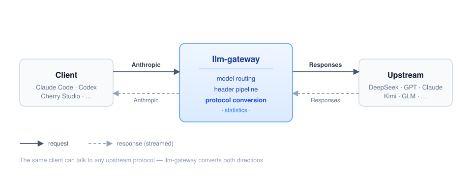
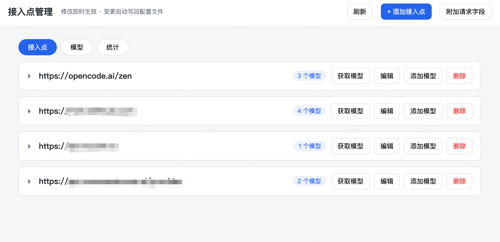
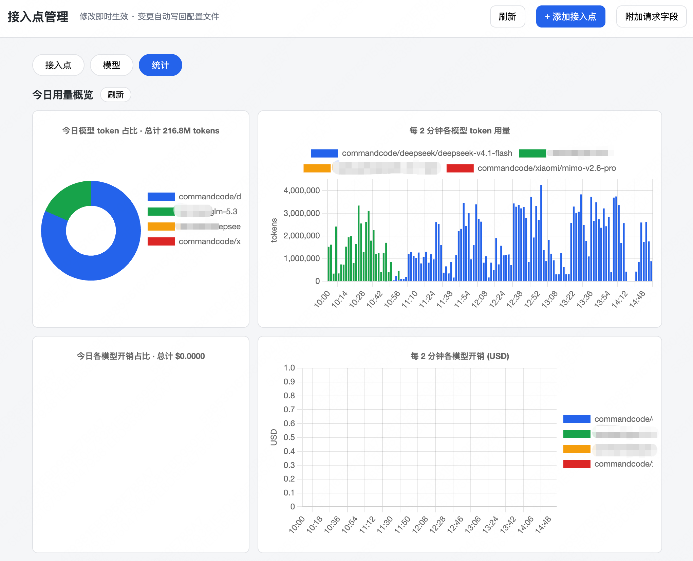
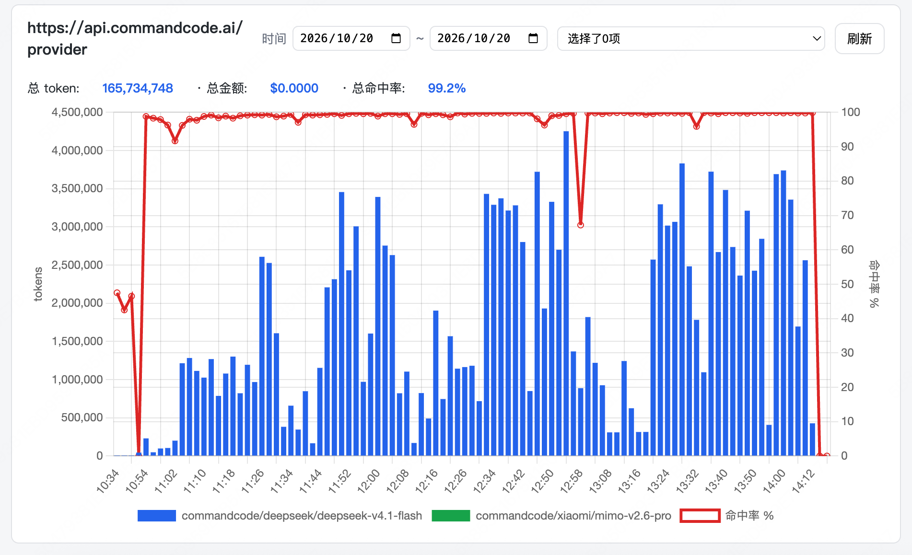
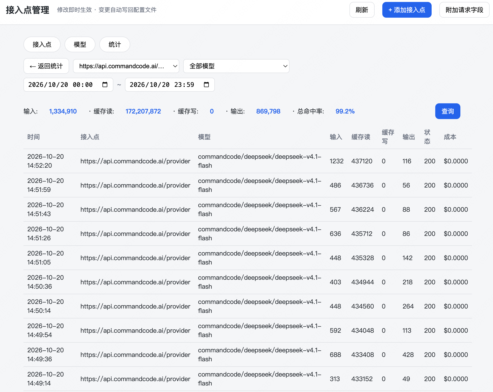

# llm-gateway

[English](README.en.md) | **中文**

一个跑在本机的 LLM 网关。把各种客户端接到它上面，网关按模型名把请求转发到对应的上游，支持模型名称替换、系统提示词修改，以及**客户端与上游协议不一致时的自动转换**。



## 功能

- **协议转换** —— OpenAI Chat、OpenAI Responses、Anthropic Messages 三种协议互通，支持全部 12 个方向。模型可固定为任一协议，客户端使用其他协议也能正常工作。
- **模型路由** —— 模型名精确匹配到上游，可为每个模型单独设置映射后的模型名和系统提示词。
- **网页管理** —— 在浏览器中管理端点和模型，修改立即生效，无需重启。
- **用量统计** —— 记录每次请求的 token 消耗、成本、TTFT 和解码速度，数据存储于本地 SQLite。
- **可复用的 SDK** —— 协议转换核心已抽离为独立包 [`apicompat`](#apicompatpython-sdk)，可直接用于其他项目。

## 安装

需要 Python 3.11 和 [uv](https://docs.astral.sh/uv/)。

```bash
git clone <repo> && cd llm-gateway
uv sync
```

### macOS 状态栏

macOS 上可以让网关常驻状态栏，无需终端即可查看状态和操作。

先安装可选依赖：

```bash
uv sync --extra menubar
```
也可以
```bash
uv sync --reinstall --all-extras --python=3.11
```

之后通过 `./gateway.sh start` 启动，状态栏会出现一个 ⚡ 图标：

- **左键点击**：打开管理界面
- **右键点击**：弹出菜单，可打开管理页面、重启服务或关闭服务
- 网关退出时图标自动消失；`./gateway.sh stop` 也会一并清理


## 启动

创建配置文件，最少只需一个上游端点：

```json
{
  "server": { "api_key": "apikey" },
  "endpoints": [
    {
      "base_url": "https://api.anthropic.com",
      "custom_headers": { "x-api-key": "sk-ant-..." },
      "models": [{ "name": "claude-sonnet-5-5" }]
    }
  ]
}
```
其中 apikey 是请求本地网关时使用的密钥。

保存为 `config.local.json`，然后启动：

```bash
./gateway.sh start
```

网关监听 `http://127.0.0.1:8088`，管理界面位于 `/admin`。


其他启动方式：

```bash
uv run python -m gateway -c config.local.json      # 前台运行，日志输出到终端
./gateway.sh start my.json --debug                 # 指定配置文件并记录完整请求日志
./gateway.sh status | stop | restart
```

## 使用

使用配置中的模型名发送请求：

```bash
curl http://127.0.0.1:8088/v1/chat/completions \
  -H "Content-Type: application/json" \
  -H "Authorization: Bearer apikey" \
  -d '{"model": "claude-sonnet-5-5", "messages": [{"role": "user", "content": "hi"}]}'
```

`apikey` 是 `server.api_key` 配置的哨兵值，网关会将其替换为端点上配置的上游密钥。

### 接入 Claude Code

```bash
export ANTHROPIC_BASE_URL=http://127.0.0.1:8088
export ANTHROPIC_AUTH_TOKEN=apikey
claude --model claude-sonnet-5-5
```

其他 OpenAI / Anthropic 兼容客户端同理：Base URL 填写 `http://127.0.0.1:8088`，API Key 填写 `apikey`，模型填写配置中的任意 `name`。

## 管理界面

浏览器打开 `http://127.0.0.1:8088/admin`

可管理端点、模型和查看统计。所有修改经过校验后原子写回配置文件并热加载，无需重启。

| 接入点管理 | 用量概览 |
|---|---|
|  |  |
| 单接入点统计 | 请求明细 |
|  |  |


## apicompat（Python SDK）

协议转换核心是一个独立的包，可安装到任意 Python 项目中使用：

```bash
pip install apicompat
```

```python
from apicompat import convert_request, convert_response, convert_stream

# 请求转换：dict 进，dict 出
upstream_body = convert_request("anthropic_messages", "openai_responses", body)

# 非流式响应转换
client_body = convert_response("openai_responses", "anthropic_messages", upstream)

# SSE 流转换：bytes 进，bytes 出
for chunk in convert_stream("openai_responses", "anthropic_messages", upstream_chunks):
    write(chunk)
```

协议名使用字符串：`"openai_chat"`、`"openai_responses"`、`"anthropic_messages"`。异步场景使用 `astream`。完整 API 见 [`packages/apicompat/README.md`](packages/apicompat/README.md)，可运行示例见 `packages/apicompat/examples/demo.py`。

## 更多文档

| | |
|---|---|
| [README.md](README.md) | English |
| [docs/DEVELOPMENT.md](docs/DEVELOPMENT.md) | 完整配置项、管理 API、统计口径、架构说明（面向开发者） |
| [packages/apicompat/README.md](packages/apicompat/README.md) | SDK 的 API 参考 |

> **安全提醒**：网关应只监听 `127.0.0.1`。管理接口没有鉴权，且会向上返回上游密钥。
